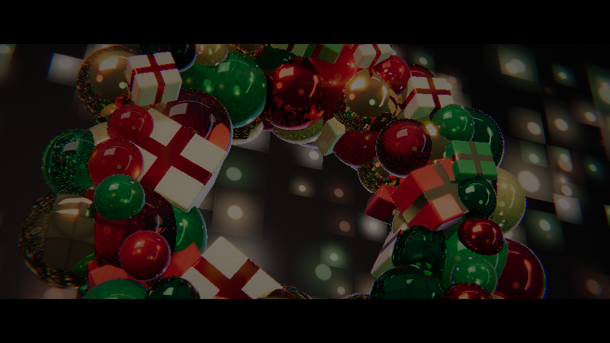

# 🎄 Shadertoy Christmas Jam 2026 🎄

## 🌐 About This Challenge

Welcome, fellow digital architects, pixel tinkerers, and code wizards!

This event is an independent community initiative organized by [Magnus 'Bagzy' Thor](https://www.shadertoy.com/user/dathor) (known as **dathor** on Shadertoy) and is not an official Shadertoy event. (Hopefully, no one minds!)

Inspired by the Shader Advent Calendar 2024 arranged by [Mårten Rånge (@mrange)](https://www.shadertoy.com/user/mrange), and the sprawling "So You Think You Can Code?" events of the past, a new approach is being taken this year. 

Instead of a scheduled month-long celebration requiring participants to claim a specific day, the calendar format has been dropped entirely. 

This year serves as an open call to the community: **Time to flood Shadertoy with Christmas cheer between December 1st and 25th!**

## 🎯 The Challenge

A challenge is hereby issued to all Shadertoyers to fiddle, create, and share festive "Christmas shaders" directly on the platform. Whether it involves procedural snow, raymarched ornaments, cozy glowing fireplaces, or fractal winter wonderlands, if it brings holiday joy, it belongs in this jam.

## 🗣️ How to Participate

1. **Code:** Create a Christmas or winter-themed shader on [Shadertoy](https://www.shadertoy.com/).
2. **Tag:** When publishing the shader, the tag **`xmasshaderjam`** must be included so the community can easily search for and view everyone's creations.
3. **Share:** Drop a link to the shader in the **Issues** tab of this repository to get it added to the gallery below!

No claiming days and no pull requests. Just publish your shaders between December 1st and 25th. Let the magic and holiday spirit begin!

---

## 🎁 The Shadertoy Christmas Jam 2026 Gallery

As shaders are submitted via the Issues tab, they will be added to this list. 

The Shadertoy platform will also be actively monitored to maintain and update this gallery. Check out the amazing festive creations from the community!

Want to see all submissions at a glance? **[Browse all #xmasshaderjam results directly on Shadertoy](https://www.shadertoy.com/results?query=tag=xmasshaderjam)**.

| Author | Shader Link | Description / Title |
| :--- | :--- | :--- |
| *dathor* | [Community Christmas Jam 2026](https://www.shadertoy.com/view/NcscWn) | An independent, community-organized push to flood Shadertoy with festive, winter-themed shaders between December 1st and 25th.Teaser. |
| | | |